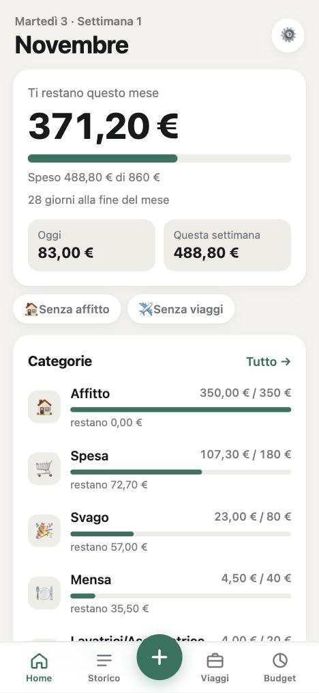
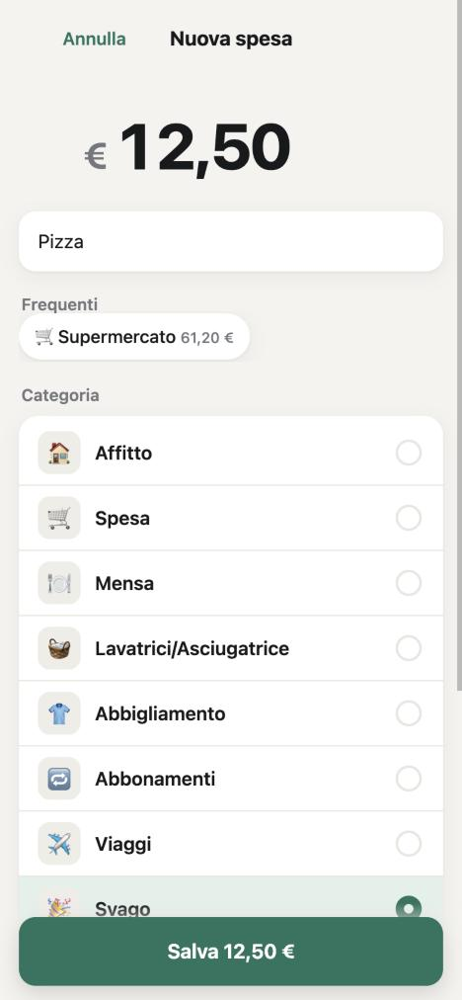
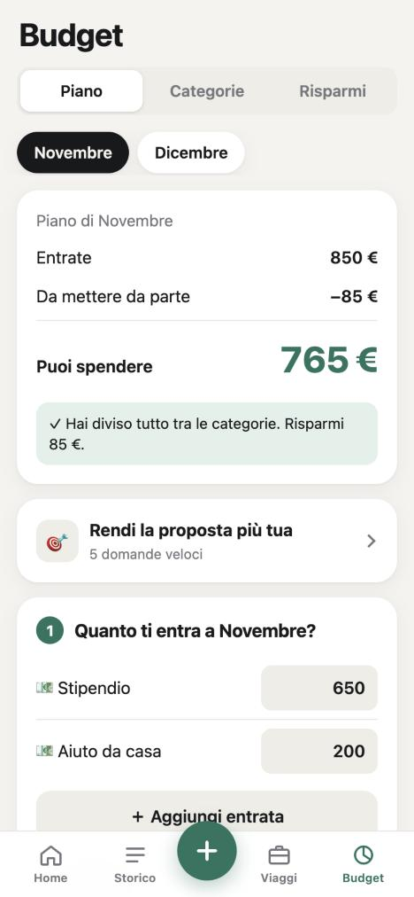

# 💶 BudgetApp – guida per installarla

Un'app per segnare le spese dall'iPhone in pochi secondi. Tutto finisce in **un tuo file Excel**: budget del mese,
risparmi, consigli, viaggi, rate su più mesi, import dell'estratto conto. Funziona anche quando il computer è spento:
le spese aspettano sul telefono e partono dopo.

<p>



</p>

> **I tuoi dati restano tuoi.** Il file Excel sta sul tuo computer o sul tuo iCloud/OneDrive. L'app non manda
> niente a nessuno (né a chi te l'ha passata). Ognuno ha la sua app e il suo file, separati.

---

## Cosa ti serve
- Un **computer** che resti acceso spesso: **Mac** (consigliato) oppure **Windows**. È il "cervello" che scrive nel file Excel.
- Un **iPhone** (va bene anche Android, con Chrome).
- Un account **Tailscale** gratuito: serve perché telefono e computer si parlino in modo sicuro, anche fuori casa.
- *(Facoltativo)* **Excel**, per guardare e modificare il file anche dal computer.

Tempo: circa 15 minuti.

---

## Passo 1 · Scarica l'app
1. Apri la pagina GitHub dell'app che ti hanno condiviso.
2. Clicca il pulsante verde **Code** e poi **Download ZIP**.
3. Apri lo ZIP scaricato: si crea una cartella `BudgetApp` (a volte si chiama `BudgetApp-main`).
4. Sposta la cartella in **Documenti**. Da qui in poi non spostarla più: l'avvio automatico la cerca lì.

## Passo 2 · Tailscale (computer e iPhone)
1. Vai su **tailscale.com**, crea un account gratuito (anche con Google o Apple).
2. Installa Tailscale **sul computer** (tailscale.com/download) e fai il login.
3. Installa l'app **Tailscale sull'iPhone** (App Store) e fai il login **con lo stesso account**. Accendila: in alto compare "VPN".
4. Attiva l'indirizzo sicuro (serve per usare l'app a computer spento):
   apri **login.tailscale.com/admin/dns**, controlla che **MagicDNS** sia attivo e, più in basso, clicca **Enable HTTPS**.

## Passo 3 · Installa l'app sul computer

### Su Mac
1. Apri il **Terminale** (premi `Cmd + Spazio`, scrivi *Terminale*, Invio).
2. Scrivi `cd ` (con lo spazio dopo), poi **trascina la cartella BudgetApp** dentro la finestra del Terminale e premi Invio.
3. Scrivi questo e premi Invio:
   ```bash
   bash installa-mac.sh
   ```
4. Ti chiede dove tenere il file Excel: premi **Invio** per la scelta consigliata (iCloud Drive › BudgetApp).
5. Alla fine vedi **✅ Fatto!** e due indirizzi: uno per il Mac, uno per l'iPhone. Copiati quello dell'iPhone.

### Su Windows
1. Apri la cartella BudgetApp, clicca con il tasto destro su **installa-windows.ps1** › **Proprietà** e, se in basso
   c'è la casella **Sblocca**, spuntala e premi OK (Windows blocca i file scaricati da internet).
2. Tasto destro su **installa-windows.ps1** › **Esegui con PowerShell**.
   Se non parte: apri PowerShell nella cartella (tasto destro con Maiusc premuto › *Apri finestra PowerShell qui*) e scrivi
   `powershell -ExecutionPolicy Bypass -File installa-windows.ps1`
3. Premi **Invio** per la posizione consigliata del file Excel.
4. Alla fine vedi **Fatto!** e l'indirizzo per l'iPhone.

> La versione Windows è nuova: se qualcosa non va, manda a chi ti ha passato l'app la scritta che vedi.

L'installatore si può rilanciare quando vuoi: **non sovrascrive mai** un file Excel che esiste già.

## Passo 4 · Metti l'app sull'iPhone
1. Con il **computer acceso** e **Tailscale acceso sul telefono**, apri **Safari** e vai all'indirizzo dell'iPhone
   (tipo `https://nome-del-computer.xxxx.ts.net`).
2. Tocca **Condividi** › **Aggiungi alla schermata Home** › **Aggiungi**.
3. Apri l'app dall'icona, chiudila del tutto e riaprila una volta. Poi tocca Home, Storico e Budget.
4. Vai in **⚙️ (in alto nella Home) › Uso con il Mac spento** (si chiama così anche su Windows): se dice **✓ Pronta**, l'app funzionerà anche a computer spento.

## Passo 5 · I primi minuti nell'app
1. **Budget › Piano**: aggiungi le tue entrate del mese con **＋ Aggiungi entrata** (nome e importo: stipendio, borsa, aiuto da casa…; scorri a sinistra per toglierne una), scegli quanto
   mettere da parte e premi **Usa questo budget**. Il quiz *"Rendi la proposta più tua"* aiuta a dividere le cifre.
2. **Budget › Categorie**: rinomina o aggiungi categorie; in fondo trovi gli **Abbonamenti** (accendi quelli da inserire in automatico ogni mese).
3. Tocca **＋** per la prima spesa: scrivi la cifra e cosa hai comprato, la categoria la propone l'app.
4. *(Facoltativo)* **⚙️ Impostazioni**: tema chiaro/scuro, colore, testo più grande, lingua (italiano/English).

---

## Facoltativo · Suggerimenti intelligenti con Claude
Se hai un abbonamento a Claude, l'app può chiedergli la categoria delle spese mai viste e darti consigli sul budget.
Sul computer, nel Terminale/PowerShell, installa Claude Code (istruzioni su **claude.com/claude-code**), scrivi `claude`,
fai il login e chiudi con `/exit`. Poi rilancia l'installatore. Senza Claude l'app funziona lo stesso.

## Aggiornare l'app
1. Scarica di nuovo lo ZIP (Passo 1).
2. Copia i file nuovi **sopra** la tua cartella BudgetApp, ma **non toccare** le cartelle `data` (dentro ci sono le correzioni
   che l'app ha imparato e le spese in coda) e `backups` (le copie di sicurezza). Il tuo file Excel non è nella cartella,
   quindi è al sicuro.
3. Rilancia l'installatore (Passo 3).
4. Sul telefono l'app si aggiorna da sola alla prima apertura con il computer acceso.

## Se qualcosa non va
| Problema | Cosa fare |
|---|---|
| *"Il Mac non è raggiungibile"* con il computer acceso (anche su Windows l'app dice "Mac") | Apri **Tailscale sul telefono** e accendilo (deve esserci "VPN" in alto). |
| Safari *"non trova il server"* | Tailscale spento sul telefono, oppure **Relay privato di iCloud** attivo (Impostazioni › il tuo nome › iCloud › Relay privato). |
| Schermo vuoto o versione vecchia | Computer acceso › ⚙️ › Uso con il Mac spento › **🔄 Ripristina l'app**, poi chiudi e riapri. |
| Le spese non arrivano nel file | Chiudi **Excel** sul computer: mentre è aperto l'app le tiene in coda e le scrive appena lo chiudi. |
| Il file Excel si è rovinato o hai cancellato qualcosa | Nella cartella `BudgetApp/backups` ci sono le copie: una **prima di ogni modifica** dell'app (ultime 50), una **al giorno** in `giornalieri` (ultimi 60 giorni) e una **al mese** in `mensili` (tutte). Chiudi Excel, spegni il computer o l'app, e copia quella giusta al posto del tuo file (rinominala come l'originale). |
| Altro | Il computer tiene un registro in `BudgetApp/logs/server.log`: mandalo a chi ti ha passato l'app. |

## Disinstallare
- **Mac**: nel Terminale `launchctl bootout gui/$(id -u)/com.budgetapp.server` e cancella
  `~/Library/LaunchAgents/com.budgetapp.server.plist`, poi la cartella BudgetApp.
- **Windows**: apri *Utilità di pianificazione*, elimina l'attività **BudgetApp**, poi la cartella.
- Il tuo file Excel resta dov'è: è tuo.
