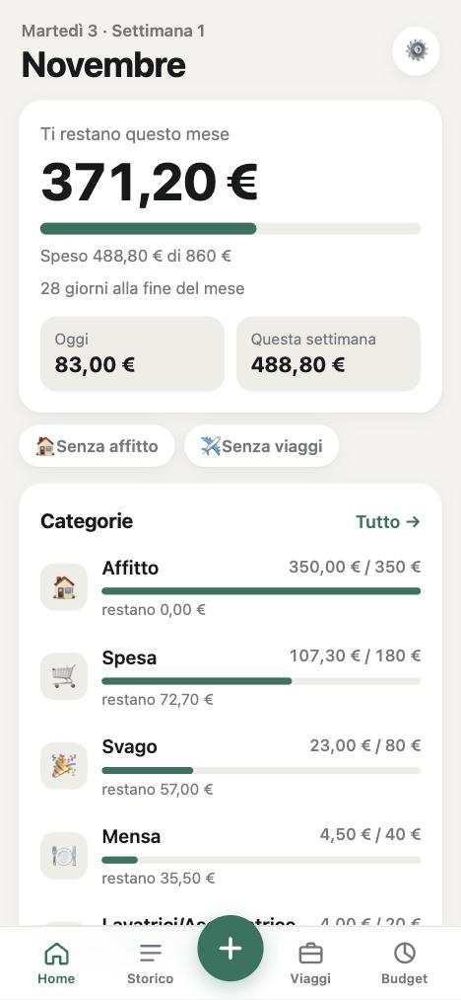
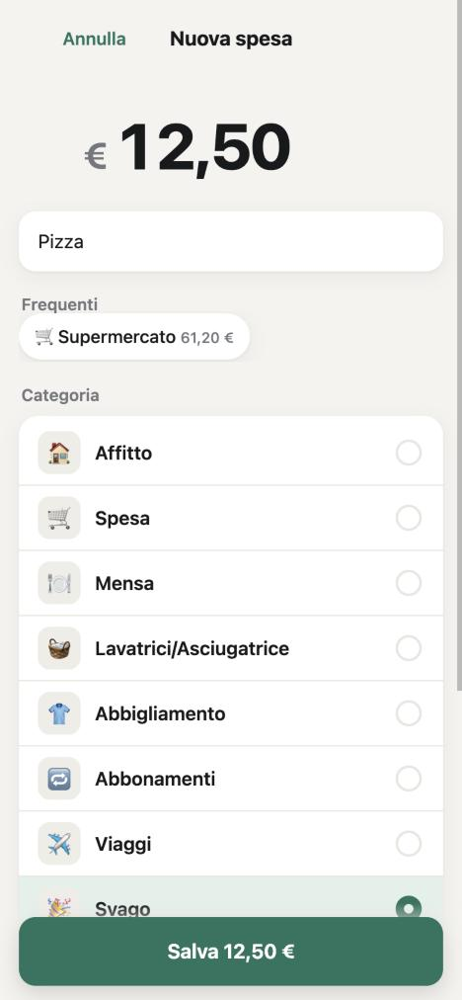
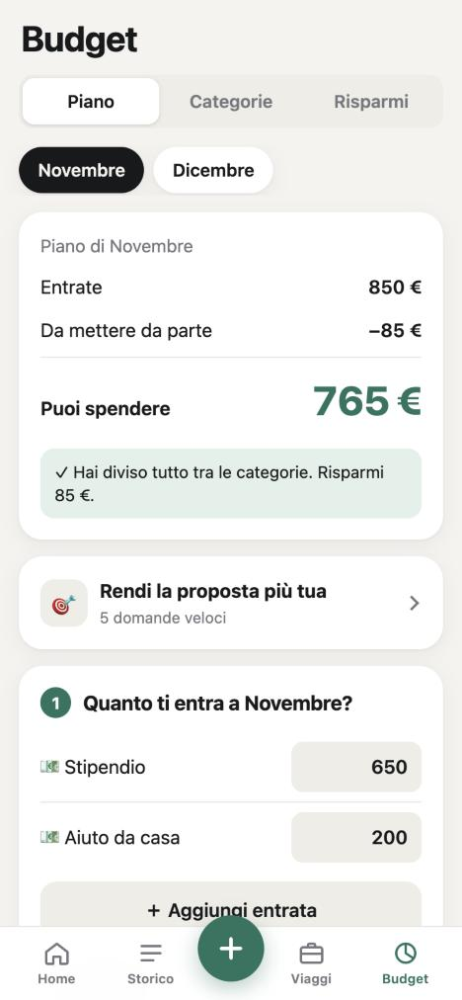

# 💶 Spese

Un'app per segnare le spese dall'iPhone in pochi secondi e tenere il budget del mese sotto controllo:
categoria suggerita, piano del budget, risparmi e consigli, viaggi, rate su più mesi, abbonamenti,
import dell'estratto conto (CSV/PDF), italiano e inglese.

## Due modi per usarla

L'app è la stessa; cambia dove stanno i dati.

| | 📱 **Solo app** (online) | 💻 **Con il tuo computer** |
|---|---|---|
| Cosa installi | niente: un link, poi *Aggiungi alla schermata Home* | l'app sul computer (Mac o Windows) + Tailscale |
| Dove stanno i dati | in un database online (Supabase), con il tuo account | in **un tuo file Excel**, sul tuo computer o iCloud/OneDrive |
| Computer acceso | non serve | serve per salvare (a computer spento le spese aspettano sul telefono) |
| Excel | lo scarichi quando vuoi; puoi importare quello che hai già | è il file stesso: lo apri e lo modifichi quando vuoi |
| Tempo per partire | 1 minuto | circa 15 minuti |
| Consigli scritti da Claude | no | sì, se hai Claude Code |

### 📱 Solo app
1. Chiedi il link a chi ti ha dato accesso a questa pagina.
2. Aprilo in Safari sull'iPhone → **Condividi** → **Aggiungi alla schermata Home**.
3. Apri l'icona e tocca **Crea un account nuovo** (email e password). Hai già un file Excel di questa app? In
   ⚙️ Impostazioni › **Importa dal vecchio Excel**.

> **Da sapere:** i dati stanno nel database di chi gestisce il link. Ognuno vede solo i suoi, protetti da email e
> password, ma chi gestisce il database potrebbe tecnicamente vederli. Se preferisci che restino solo tuoi, usa
> l'altro modo.

### 💻 Con il tuo computer
Segui **[GUIDA.md](GUIDA.md)**: passo passo, con le immagini. Dopo si aggiorna da sola.

---

<b>Per chi sviluppa</b> (struttura del progetto)

- `server/` – il "cervello" della versione con il computer: API (FastAPI) che legge e scrive il file Excel, suggerimenti, consigli, import estratti conto
- `web/` – l'interfaccia (la stessa nelle due versioni), `i18n.js` per l'inglese
- `scripts/` – manutenzione del file Excel; `modello/` – il file Excel vuoto da cui partire
- `installa-mac.sh`, `installa-windows.ps1`, `avvia.py`, `launchd/` – installazione e avvio automatico
- La versione **solo app** è nel ramo [`prova-supabase`](../../tree/prova-supabase/indipendente): stessa interfaccia di `web/`, con un piccolo "server nel telefono" al posto di `server/` e i dati su Supabase.
- `brain/` e `CLAUDE.md` – appunti di lavoro per l'assistente (Claude) che sviluppa l'app: si possono ignorare.

Variabili della versione con il computer: `BUDGET_XLSX` (file Excel), `BUDGET_DATA`, `BUDGET_BACKUPS` (cartelle di dati e copie di sicurezza), `BUDGET_AI` (`cli`, `api`, `off`).
File personali facoltativi, mai su GitHub: `data/keywords_local.json` (parole chiave tue), `data/contesto.txt` (una frase su di te per i consigli).

Licenza: [uso personale](LICENSE) – gratis per le tue spese, senza modificarla né ridistribuirla.
